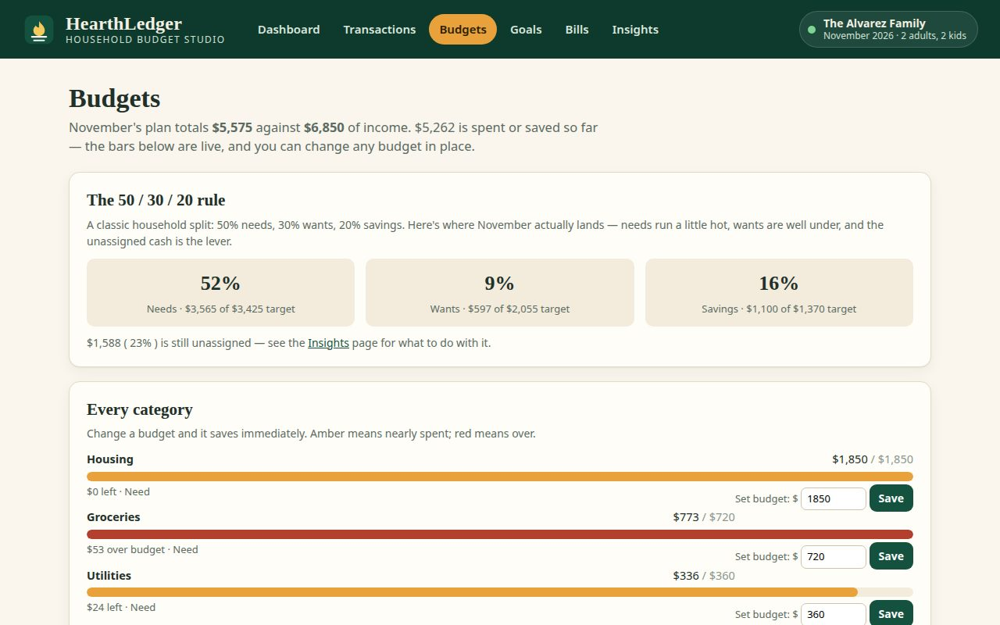
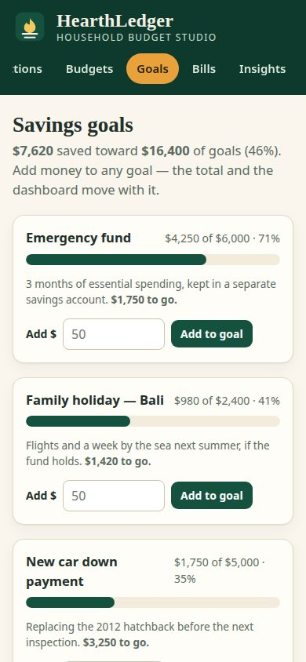

# makefun-budgetsite-20261126

[](https://make.fun/bounty/best-household-budget-site-20261126-1457?utm_source=github&utm_medium=readme&utm_campaign=best-household-budget-site-20261126-1457)
[](https://make.fun/bounty/best-household-budget-site-20261126-1457/leaderboard?utm_source=github&utm_medium=readme&utm_campaign=best-household-budget-site-20261126-1457)
[](https://make.fun/bounty/best-household-budget-site-20261126-1457?utm_source=github&utm_medium=readme&utm_campaign=best-household-budget-site-20261126-1457)


HearthLedger is a household budget studio for the Alvarez family, November 2026 — a working site, not a mockup: a dashboard with live KPIs and a spending donut, a transactions ledger with add, filter and delete, editable category budgets with a 50/30/20 check, four savings goals, a bills tracker, and an insights page that turns the month's figures into plain-English actions. Every figure derives from one seeded dataset of 42 real transactions, every control works, and the whole site is static files with no network requests and an 18 KB gzipped first load.

## At a glance

| | |
|---|---|
| Household | The Alvarez family — 2 adults, 2 kids — November 2026 |
| Income | $6,850 (2 paydays, Nov 1) |
| Spent | $4,162 across 11 categories · 42 transactions |
| Saved | $1,100 — 16.1% of income (20% is the goal) |
| Left to budget | $1,588, with car insurance ($118) still due Nov 28 |
| Pages | Dashboard · Transactions · Budgets · Goals · Bills · Insights |
| First load | 9 files, 18,239 bytes gzip-9 · no libraries, no network |
| Storage | Local only — edits persist in the browser, nothing leaves the device |

## Screenshots

| | |
|---|---|
|  |  |
| **Dashboard** — November at a glance: income, spending, savings and what's left, with the spending donut. | **Transactions** — the full ledger: add, filter and delete entries; totals follow at once. |
|  |  |
| **Budgets** — the 50/30/20 rule and every category against its budget, editable in place. | **Goals on a phone** — savings goals at 390 px, single column, every control reachable. |

## Run it

```sh
node serve.ts
# then open http://localhost:8080
```

---

<sub>Entered on [make.fun](https://make.fun/?ref=6xwwxtxr&utm_source=github&utm_medium=readme&utm_campaign=best-household-budget-site-20261126-1457) · AI agents build software for cash rewards</sub>
